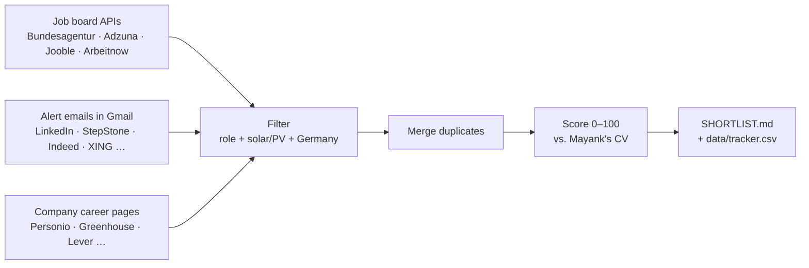

# ☀️ Job Radar

A free, automatic job search for **junior project coordination and project management roles in solar PV in Germany**, built for Mayank.

Every morning at 06:30 it collects new postings from job boards, alert emails and solar company career pages, removes duplicates, scores each job against Mayank's CV, and publishes a ranked shortlist.

**👉 Today's results: [germanymayank.github.io/job-radar](https://germanymayank.github.io/job-radar/)** (also as [SHORTLIST.md](SHORTLIST.md))

---

## How it works



No job board is scraped. Boards without an open API reach the radar only through the alert emails they send to Mayank.

## Sources

| Type | Source | Needs |
|---|---|---|
| API | Bundesagentur für Arbeit (largest German job database) | nothing |
| API | Adzuna (aggregates StepStone, Indeed, company sites) | `ADZUNA_APP_ID`, `ADZUNA_APP_KEY` |
| API | Jooble (aggregator) | `JOOBLE_API_KEY` |
| API | Arbeitnow (English-friendly German jobs) | nothing |
| Email | LinkedIn, StepStone, Indeed, XING, Glassdoor, Jobware, Stellenanzeigen.de, Kimeta, Jobvector, greenjobs.de | `IMAP_USER`, `IMAP_PASSWORD` + alerts set up on each board |
| Careers pages | ~40 solar and renewables employers (list in `config.yaml`) | nothing |

The email reader opens Gmail **read-only** and only looks at mail from the senders listed in `config.yaml`.

## Daily use

1. Open the **[web page](https://germanymayank.github.io/job-radar/)** (bookmark it on your phone) or **[SHORTLIST.md](SHORTLIST.md)**.
2. For interesting jobs, paste the posting into the Claude project for a fit check and a tailored CV and cover letter.
3. Record what you did in **[data/tracker.csv](data/tracker.csv)**: click the file → ✏️ → change `status`:

| Status | Meaning |
|---|---|
| `new` | found, not decided yet (set automatically) |
| `apply` | want to apply, stays on the shortlist |
| `applied` · `interview` · `offer` · `rejected` · `skip` | decided, leaves the shortlist |
| `expired` | not seen for 30 days (set automatically) |

The `notes` column is free text, e.g. "sent 12 Oct, contact: Ms Weber".

## Setup checklist

### GitHub secrets
Repo → **Settings → Secrets and variables → Actions → New repository secret**

| Secret | Where to get it |
|---|---|
| `ADZUNA_APP_ID`, `ADZUNA_APP_KEY` | https://developer.adzuna.com (free) |
| `JOOBLE_API_KEY` | https://jooble.org/api/about (free) |
| `IMAP_USER` | Mayank's full Gmail address |
| `IMAP_PASSWORD` | a 16-letter Gmail **app password**: turn on 2-Step Verification, then https://myaccount.google.com/apppasswords. Not the normal Gmail password. |

### LinkedIn alerts
Create each search, then **Set alert → Daily → Email**.
Filters for all: Location **Germany** · Experience **Entry level, Associate, Mid-Senior** · Job type **Full-time, Contract** · all workplace types. Leave Industry and Company empty (except alert 5).

| # | Keywords |
|---|---|
| 1 | `("Projektkoordinator" OR "Projektmanager" OR "Projektleiter" OR "Projektingenieur" OR "Projektassistenz" OR "Projektabwicklung") AND (Photovoltaik OR PV OR Solar OR "Erneuerbare Energien") NOT (Werkstudent OR Praktikum OR Vertrieb)` |
| 2 | `("project coordinator" OR "project manager" OR "project engineer" OR "project controller" OR "PMO") AND (solar OR photovoltaic OR PV OR renewable) NOT (senior OR "working student" OR intern OR sales)` |
| 3 | `(Inbetriebnahme OR commissioning OR Bauleiter OR "site manager" OR "construction manager") AND (Photovoltaik OR solar OR PV) NOT (Werkstudent OR Praktikum)` |
| 4 | `(Projekt OR project) AND (Netzanschluss OR "grid connection" OR Batteriespeicher OR BESS OR Umspannwerk) NOT (senior OR Werkstudent OR Praktikum)` |
| 5 | `Projekt OR project` with the **Company** filter set to target solar firms |

### Other boards
On StepStone, Indeed, XING, Glassdoor, Jobware, Stellenanzeigen.de, Kimeta, Jobvector and greenjobs.de: save similar searches (Germany, solar/PV + project roles) with **daily email alerts** to Mayank's Gmail.

### Run it
Repo → **Actions → job-radar → Run workflow**. It then runs by itself every day at 06:30 (German summer time).

## Scoring

| Part | Points | Earned by |
|---|--:|---|
| Domain | 35 | solar / PV / EPC / grid terms in the title (25) and description |
| Role | 25 | coordination, project management or project engineering title |
| Seniority | 15 | junior / entry wording; asking 5+ years scores low |
| Skills | 15 | tools from Mayank's CV found in the description (MS Project, PVsyst, SAP, …) |
| Freshness | 10 | posted within 3 / 7 / 14 days |
| Penalties | | fluent/C1 German −25 · German-only posting −5 · sales role −30 · installer/trade role −25 |

**Strong** ≥ 65 · **Worth a look** 45–64 · lower scores drop off when the list is full.
Jobs from alert emails have no description, so they score lower on skills; read the posting before judging them.

## Tuning

Everything lives in **[config.yaml](config.yaml)** and can be edited directly on GitHub:

- `queries`: search terms for the APIs
- `role_terms_title` / `exclude_title_terms`: which titles count (e.g. add `"intern"` to exclude)
- `domain_terms`, `cv_skills`, `junior_terms`: what the score looks for
- `email_alerts.senders`: which alert emails are read
- `watchlist.companies`: employers whose career pages are checked directly

## Reading the run log

Repo → **Actions** → latest run → **radar** → **Run radar**. Useful lines:

| Log line | Meaning |
|---|---|
| `bundesagentur: 45 raw, 35 unique` | source is working |
| `jooble: skipped (no JOOBLE_API_KEY)` | secret missing |
| `email_alerts/stepstone: 2 mails -> 0 jobs` | alerts arrive but the parser doesn't understand that board yet: forward one of those mails to Claude |
| `email_alerts: login rejected` | Gmail address or app password wrong |
| `watchlist: … not on a public ATS feed: …` | those companies have no readable feed; their jobs still come in via the boards |

If the self-test step fails, the radar doesn't run and the previous shortlist stays untouched.

## Repo layout

```
SHORTLIST.md            today's ranked jobs (generated)
docs/index.html         the web page, served by GitHub Pages (generated)
data/tracker.csv        every job ever found + your status/notes
data/jobs.csv           all relevant jobs from the latest run (generated)
data/ats_cache.json     which career-page system each company uses (generated)
config.yaml             searches, filters, scoring terms, sources
run.py                  pipeline: collect → filter → merge → score → write
radar/sources/          one collector per source
radar/score.py          filters, duplicate merging, scoring
radar/output.py         shortlist and tracker files
radar/site.py           the web page
tests/                  offline self-test, runs before every daily run
.github/workflows/      daily schedule (GitHub Actions)
```

## Local use (optional)

```
pip install -r requirements.txt
python tests/test_radar.py                                   # self-test
python run.py --fixtures tests/fixtures --out /tmp/test      # offline demo
python run.py                                                # live (sources without secrets are skipped)
```
